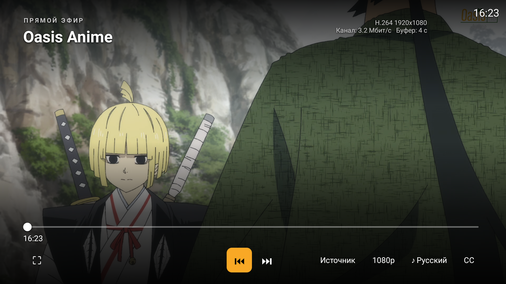

# LMPC Channel Manager

Лицензирование: [PolyForm Noncommercial 1.0.0](LICENSE.md) для самостоятельных материалов Lepi4. Разрешены некоммерческое использование, копирование, изменение и распространение. [Область действия и лицензии стороннего кода](LICENSE-SCOPE.md).

Local IPTV channel management and an HLS/MPEG-TS buffer for Lampa Home Media Center.
Supports Tvheadend, Enigma2 and M3U sources, XMLTV EPG, per-source priorities,
fallback streams and optional FFmpeg transcoding. Intended for a trusted home LAN.

## Что это за сервис

Channel Manager — отдельный сервер управления телевидением для [LMPC Media Center](https://gitverse.ru/Lepi4/lampa-home-module) и других клиентов, работающих с M3U/XMLTV и HTTP-потоками. Он может быть установлен самостоятельно или вместе с Lampac в одном контейнере. Это не Android-плеер и не поставщик телеканалов: источники и доступ к ним настраивает владелец.

### Основные возможности

- **Источники:** импорт M3U и синхронизация с Tvheadend/Enigma2; включение источников, настройка приоритетов и фильтрация групп.
- **Единый список каналов:** названия, номера, группы, логотипы, порядок, включение/выключение и редактирование каналов. Для одного канала можно хранить несколько вариантов источника.
- **Приоритеты и резерв:** основной поток выбирается из доступных вариантов; при проблемах сервис может перейти к резервному. Наличие независимого резерва зависит от добавленных источников.
- **Программа передач:** загрузка XMLTV, сопоставление каналов с EPG и выдача общей программы для клиентов.
- **Потоки:** выдача MPEG-TS по HTTP, чтение HLS/MPEG-TS источников, общий сеанс канала и подключение нескольких клиентов к одной сессии.
- **Буферизация и устойчивость:** контроль поступления данных, переподключение, обработка зависаний HLS и выравнивание выдачи потока. Размер буфера и интервалы задаются конфигурацией.
- **FFmpeg по необходимости:** деинтерлейс, перекодирование видео/звука и унификация потока для клиентов; VAAPI требует подходящего GPU, драйверов и доступа к устройству. Производительность зависит от сервера и числа потоков.
- **Необязательная обработка громкости:** таблица поправок и downmix; настройка `audio_gain_fix_enabled` по умолчанию выключена.
- **Веб-панель и диагностика:** управление источниками/каналами, обновление EPG, текущие сессии, ошибки, состояние буфера и сброс отдельного зависшего сеанса.

### Связь с APK и HomeMedia

Channel Manager предоставляет список каналов, программу и поток. HomeMedia использует их для серверного ТВ-раздела и правил доступа профилей. Android APK показывает список/EPG, запускает эфир, переключает каналы и предлагает варианты источников в плеере. Настраиваемый автозапуск последнего канала относится к APK.

Channel Manager не хранит персональные таймкоды фильмов и не синхронизирует профили медиaцентра — это функции HomeMedia. Он также не заменяет TorrServer.

### Пример связанного клиента

Ниже — реальный снимок ТВ-плеера LMPC от 28 октября 2026 года, который показывает результат совместной работы с Channel Manager. Это интерфейс Android APK, а не веб-панель Channel Manager. Видны название канала, параметры потока, переключение источника, качество, звук и субтитры.



| Адрес сервиса | Назначение |
| --- | --- |
| `/` | Веб-панель |
| `/playlist.m3u8` | Общий плейлист включённых каналов |
| `/xmltv` | Программа передач XMLTV |
| `/stream/<id>` | Поток канала; `?src=N` выбирает конкретный источник |
| `/tsb/sources/<id>` | Источники канала и их приоритеты |
| `/tsb/status` | Сессии и состояние буферизации |
| `/tsb/config` | Настройки буферизации и обработки |
| `POST /tsb/session/<id>/reset` | Сброс отдельной сессии |

Сервис предназначен для доверенной локальной сети. Для внешнего доступа нужна отдельная защищённая схема доступа; веб-панель и API не следует открывать напрямую в интернет.

## Run

Requires Python 3.11 or later, aiohttp 3.x, and FFmpeg for transcoding.
Validated on Debian 13 with Python 3.13 and aiohttp 3.11.16.

```sh
python3 -m venv .venv
.venv/bin/pip install -r requirements.txt
sudo mkdir -p /opt/channel-manager
cp config.example.json /opt/channel-manager/config.json
.venv/bin/python channel_manager.py --port 3002 --db /opt/channel-manager/channels.db
```

Open `http://localhost:3002` and add your own sources. The server listens on all
interfaces. This repository contains no preconfigured accounts or channels.
`CHANNEL_MANAGER_CONFIG` overrides the configuration file location.
`--version` reports the source version without starting the service.

The output playlist is `/playlist.m3u8`; runtime status is `/tsb/status`.
Channel/EPG synchronization runs every six hours by default. That synchronization
does not update the program.

## State and updates

Keep `config.json`, `channels.db` and its SQLite WAL files, `channel_gain.json`,
`hls_back.json`, and `probe_cache.json` outside Git. Source URLs and credentials
are stored in the local database and must never be published.

`build_release.py` creates `channel-manager.tar.gz` for the LMPC panel. It contains
only program files and a version manifest. The panel's update path checks the
package checksum/manifest, compiles the Python source, and retains the existing
database/configuration. It does not install or update Python dependencies automatically.

The panel can check or prepare a release on a daily schedule. Applying an update
is manual; it restarts the selected service and can briefly interrupt television.
The previous program is backed up before replacement. Program rollback keeps
newer channels and preferences. Database schema migrations must remain backward
compatible with the preceding release.

Build and validate a release locally:

```sh
python3 tests.py
python3 build_release.py --output dist
```

The `.github/workflows` files are retained from GitHub. They do not run automatically
in GitVerse. A Git push publishes the source; it does not create a hosted release
or move the media center's existing update source to GitVerse.

## Исходники и данные

Основная программа — [channel_manager.py](channel_manager.py). В ней объединены управление каналами, веб-панель, EPG и обработка потоков; отдельный старый `ts_buffer.py` для запуска этой версии не требуется. [measure_gain.py](measure_gain.py) — дополнительный инструмент измерения громкости, [migrate_from_tvlink.py](migrate_from_tvlink.py) — инструмент миграции со старой структуры tvlink.

Для первого запуска используйте [config.example.json](config.example.json) и добавьте собственные источники через панель. Пользовательские `channels.db`, конфигурации, плейлисты, пароли, токены, бэкапы и диагностические дампы не входят в публичный репозиторий.

Собственные материалы Lepi4 разрешено использовать, копировать, изменять и распространять в некоммерческих целях по [PolyForm Noncommercial 1.0.0](LICENSE.md). [Область действия и сохранение сторонних лицензий](LICENSE-SCOPE.md).
